# wfmR

`wfmR` contains Will Mackey's R chart defaults and Quarto formats for
research notes, policy briefs, papers, and slides.

``` r
wfm_colours()
#>    salmon      teal    purple      lime    yellow      blue      pink 
#> "#D7827E" "#56949F" "#907AA9" "#8B9A5A" "#EA9D34" "#286983" "#B4637A"
```

## Palette and Tints

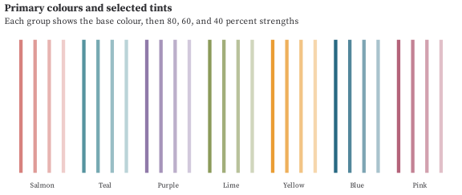<!-- -->

``` r
wfm_tints(wfm_colours("teal", "salmon", "yellow", "pink"), strength = c(90, 60, 30, 10))
#>    teal90  salmon90  yellow90    pink90    teal60  salmon60  yellow60    pink60 
#> "#669EA8" "#DB8E8A" "#ECA648" "#BB7287" "#99BEC5" "#E7B4B1" "#F2C485" "#D2A1AF" 
#>    teal30  salmon30  yellow30    pink30    teal10  salmon10  yellow10    pink10 
#> "#CCDEE2" "#F3D9D8" "#F8E1C2" "#E8D0D7" "#EEF4F5" "#FBF2F2" "#FCF5EA" "#F7EFF1"
```

The default colours are also available as objects:

``` r
c(
  wfm_salmon,
  wfm_teal,
  wfm_purple,
  wfm_lime,
  wfm_yellow,
  wfm_blue,
  wfm_pink
)
#> [1] "#D7827E" "#56949F" "#907AA9" "#8B9A5A" "#EA9D34" "#286983" "#B4637A"
```

Tint constants use the percentage of original colour retained:
`wfm_teal90` is close to teal, while `wfm_teal10` is very pale.

``` r
c(wfm_teal90, wfm_teal70, wfm_teal50, wfm_teal30, wfm_teal10)
#> [1] "#669EA8" "#88B4BB" "#AAC9CF" "#CCDEE2" "#EEF4F5"
```

The primary palette is checked under severe deutan, protan, and tritan
simulation. The full seven-colour palette is shown because it is the
default brand/chart sequence; for dense categorical encodings, use
direct labels or additional aesthetics when colours may be hard to
distinguish.

``` r
wfm_colour_blind_report()
#>      cvd min_distance colour_1 colour_2 passes
#> 1   none    14.004533   salmon     pink   TRUE
#> 2 deutan     4.397336     teal   purple  FALSE
#> 3 protan     9.342585     blue     pink   TRUE
#> 4 tritan     6.871752   salmon   yellow  FALSE
```

Available discrete, sequential, and diverging options:

``` r
wfm_palette_options()[, c("type", "name", "generator", "notes")]
#>          type               name generator
#> 1    discrete            primary     fixed
#> 2    discrete               wong     fixed
#> 3    discrete        colourblind     fixed
#> 4  sequential   blue_teal_yellow   anchors
#> 5  sequential  blue_green_yellow   anchors
#> 6  sequential purple_pink_salmon   anchors
#> 7  sequential   teal_lime_yellow   anchors
#> 8  sequential   blue_purple_pink   anchors
#> 9   diverging        teal_salmon   anchors
#> 10  diverging        blue_yellow   anchors
#> 11  diverging         green_pink   anchors
#> 12  diverging        purple_lime   anchors
#> 13  diverging        blue_salmon   anchors
#>                                                                          notes
#> 1                         Default soft Rose Pine-inspired wfmR chart sequence.
#> 2                               Original Wong/Colour Universal Design palette.
#> 3          Colour-blind-friendly publication backup based on the Wong palette.
#> 4                        Default blue-to-teal-to-pale-yellow sequential scale.
#> 5                    Blue-to-green-to-pale-yellow scale for ordered intensity.
#> 6                    Purple-to-pink-to-salmon scale with a pale warm endpoint.
#> 7                   Teal-to-lime-to-pale-yellow scale for positive quantities.
#> 8                             Blue-to-purple-to-pink scale for dense heatmaps.
#> 9                                      Default teal-to-salmon diverging scale.
#> 10               Blue-to-yellow diverging scale with high endpoint separation.
#> 11 Green-to-pink diverging scale; clearer than teal/pink under CVD simulation.
#> 12                                             Purple-to-lime diverging scale.
#> 13                                             Blue-to-salmon diverging scale.
```

## Categorical Palettes

Discrete chart scales use `scale_fill_wfm()` or `scale_colour_wfm()`.
The primary palette is the package default; the Wong/Colour Universal
Design palette is retained as a colour-blind-friendly backup via
`palette = "colourblind"` or `palette = "wong"`.

### Primary

``` r
primary_df |>
  ggplot(aes(group, value, fill = group)) +
  geom_col(width = 0.72) +
  scale_fill_wfm(palette = "primary") +
  scale_y_wfm(limits = c(0, NA)) +
  labs(
    title = "Primary categorical palette",
    subtitle = "The default wfmR order: salmon, teal, purple, lime, yellow, blue, pink",
    x = NULL,
    y = "Value",
    caption = "Illustrative data."
  ) +
  theme_wfm()
```

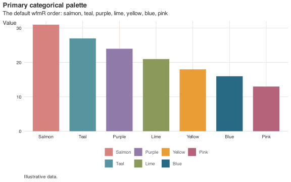<!-- -->

### Publication Backup

``` r
wong_df |>
  ggplot(aes(group, value, fill = group)) +
  geom_col(width = 0.72) +
  scale_fill_wfm(palette = "colourblind") +
  scale_y_wfm(limits = c(0, NA)) +
  labs(
    title = "Colour-blind-friendly categorical palette",
    subtitle = "The original Colour Universal Design palette remains available",
    x = NULL,
    y = "Value",
    caption = "Illustrative data."
  ) +
  theme_wfm()
```

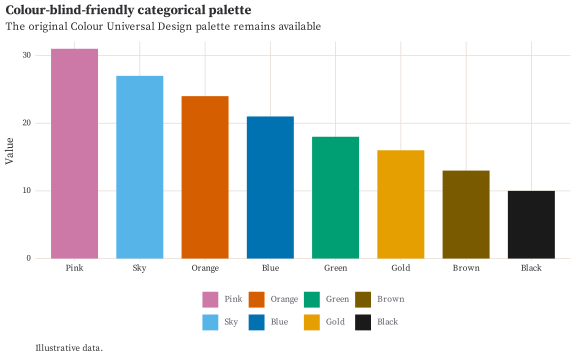<!-- -->

### Categorical Scatter

``` r
mtcars_cyl |>
  ggplot(aes(wt, mpg, colour = cyl)) +
  geom_point(size = 2.5, alpha = 0.88) +
  scale_colour_wfm(palette = "primary") +
  scale_y_wfm() +
  labs(
    title = "Categorical colour also works for points",
    subtitle = "Cylinder count is mapped to the primary palette",
    x = "Weight (1,000 lbs)",
    y = "Miles per gallon",
    caption = "Source: R datasets package."
  ) +
  theme_wfm()
```

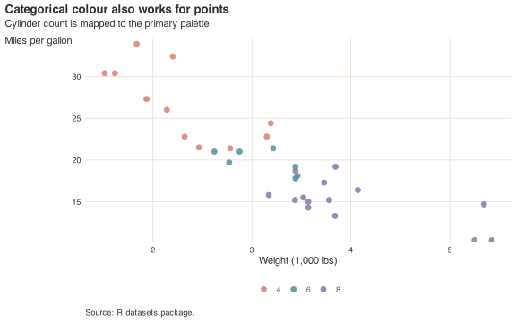<!-- -->

## Sequential Palettes

Sequential palettes are for ordered quantities. Each facet below uses
one available sequential palette.

``` r
seq_df |>
  ggplot(aes(x, y, fill = fill)) +
  geom_tile() +
  scale_fill_identity() +
  coord_equal(expand = FALSE) +
  facet_wrap(vars(palette_label), ncol = 2) +
  labs(
    title = "Sequential palette options",
    subtitle = "Each panel maps the same ordered surface using one wfmR sequential palette",
    x = NULL,
    y = NULL,
    caption = "Source: R datasets package."
  ) +
  theme_wfm(grid = FALSE) +
  theme(
    axis.text = element_blank(),
    axis.ticks = element_blank(),
    legend.position = "none",
    strip.text = element_text(face = "bold")
  )
```

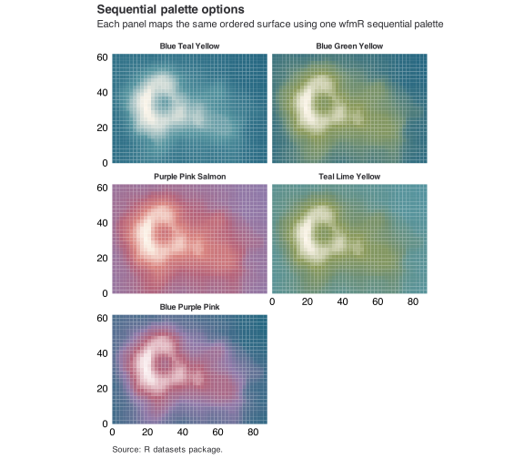<!-- -->

## Diverging Palettes

Diverging palettes are for quantities centred on a meaningful midpoint.
Each facet below maps the same centred surface around zero.

``` r
div_df |>
  ggplot(aes(x, y, fill = fill)) +
  geom_tile() +
  scale_fill_identity() +
  coord_equal(expand = FALSE) +
  facet_wrap(vars(palette_label), ncol = 2) +
  labs(
    title = "Diverging palette options",
    subtitle = "Each panel maps the same zero-centred surface using one wfmR diverging palette",
    x = NULL,
    y = NULL,
    caption = "Source: R datasets package."
  ) +
  theme_wfm(grid = FALSE) +
  theme(
    axis.text = element_blank(),
    axis.ticks = element_blank(),
    legend.position = "none",
    strip.text = element_text(face = "bold")
  )
```

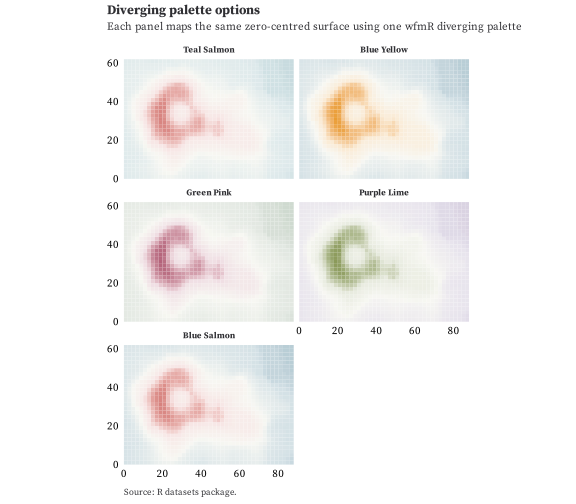<!-- -->

## Quarto

Create a new Quarto document and install the bundled extension beside
it:

``` r
library(wfmR)

use_wfmr_doc("analysis.qmd", format = "html")
use_wfmr_doc("serif-analysis.qmd", format = "html", serif = TRUE)
use_wfmr_doc("paper.qmd", format = "pdf")
use_wfmr_doc("working-paper.qmd", format = "all", style = "academic", serif = TRUE)
use_wfmr_doc("slides.qmd", format = "revealjs")
```

For an existing document, install the extension once with:

``` r
use_wfmr_extension()
```

The default `"nice"` style uses `wfmr-html` for HTML notes and
`wfmr-pdf` for LaTeX/PDF documents. It gives charts a Grattan-style
heading above the figure, with subtitles also above and notes/sources
below. The `"academic"` style uses `wfmr-academic-html` and
`wfmr-academic-pdf`; it gives academic PDFs a title page with an
abstract, places figure captions below figures, places table captions
above tables, and keeps subtitles, notes, and sources with the same
float. Slides use `wfmr-revealjs`.

The extension supplies the chart-notes Lua filter, chart cross-reference
defaults, HTML/revealjs theme files, and LaTeX header file
automatically. The YAML below shows the main document options you can
override directly. Standard Quarto options can be added in the same
place.

### Style Notes

-   The primary chart palette now follows a softer Rose Pine-inspired
    direction: salmon, teal, purple, lime, yellow, blue, and pink. Green
    remains available as an exported constant, but is excluded from the
    primary chart order because it sits too close to lime in this
    palette. The Wong/Colour Universal Design palette is retained as
    `palette = "colourblind"` or `palette = "wong"`.
-   The HTML and revealjs formats include a Quarto `_brand.yml` layer
    with light Dawn and dark Moon colour mappings, after the base
    Bootswatch theme and before the package SCSS. LaTeX/PDF uses the
    same palette in `latex-header.tex` because Quarto brand files do not
    currently style LaTeX output.
-   Tints are generated by mixing each primary colour towards white. For
    example, `wfm_teal90` keeps 90 percent of teal and `wfm_teal10` is
    close to white.
-   Sequential and diverging scales are derived from the primary colours
    and their tints, using OKLab interpolation for smoother continuous
    gradients.
-   The nice HTML format follows `topics/course-notes.qmd` and the eyes
    writeups: Quarto `cosmo`/`darkly`, embedded resources, code
    annotations/folding/tools, optional left table of contents, SVG
    plots, chart headings above figures, and notes/sources below
    figures.
-   HTML documents can opt into serif prose by setting `mainfont`, or by
    calling `use_wfmr_doc(..., serif = TRUE)`. The serif option bundles
    Newsreader as a local variable WOFF2 font, with Georgia, Cambria,
    Iowan Old Style, and Palatino fallbacks. Charts, code, navigation,
    and table of contents UI stay in the system sans-serif stack. The
    bundled Newsreader files are included under the SIL Open Font
    License in `inst/quarto/_extensions/wfmr/fonts/newsreader/`.
-   The generic coloured labels, note block, and chart notes come from
    `R/styles.css`, `case-study/eyes/code/chart-labels.R`, and
    `case-study/eyes/code/chart-notes.lua`.
-   The nice PDF format comes from
    `case-study/eyes/writeup-nontechnical.qmd`: A4 `article`, 11pt type,
    1.2 line stretch, black citation/link colour, chart captions, and a
    LaTeX header adapted from Pascal Michaillat's paper template using
    Source Serif Pro when available, centred bold section headings, bold
    subsections, italic run-in paragraph headings, and French spacing.
-   The academic HTML/PDF formats keep the same page, palette, and chart
    defaults, opt into serif prose for HTML, and use bottom captions and
    quieter figure notes for papers, working papers, and thesis
    chapters.
-   The revealjs theme is derived from the HTML rules: system UI type,
    restrained headings, Rose Pine links, the same chart metadata, and
    the same package palette.

### Nice Article YAML: HTML + PDF

``` yaml
---
title: "Research note"
subtitle: "One page of text and one chart"
author: "Will Mackey"
brand: "_extensions/wfmr/_brand.yml"
format:
  wfmr-html:
    fig-format: svg
    embed-resources: true
    code-annotations: below
    code-fold: show
    code-tools: true
    toc: true
    toc-location: left
    toc-depth: 3
    toc-expand: true
    fig-cap-location: top
    df-print: paged
  wfmr-pdf:
    documentclass: article
    papersize: a4
    geometry:
      - top=1in
      - left=1.3in
      - right=1.3in
      - bottom=1.2in
      - footskip=0.7in
    fontsize: 11pt
    linestretch: 1.2
    toc: false
    colorlinks: true
    linkcolor: black
    citecolor: black
    urlcolor: black
    link-citations: true
    link-bibliography: true
    fig-cap-location: top
    tbl-cap-location: top
    fig-pos: tb
execute:
  warning: false
  message: false
crossref:
  fig-title: Chart
  fig-prefix: Chart
---
```

[Source QMD](examples/wfmr-demo.qmd) \| [HTML
example](examples/wfmr-demo.html) \| [PDF
example](examples/wfmr-demo.pdf)

HTML screenshot:

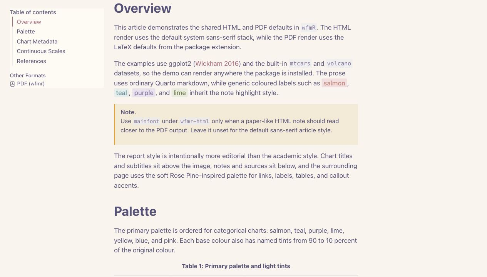

PDF screenshot:

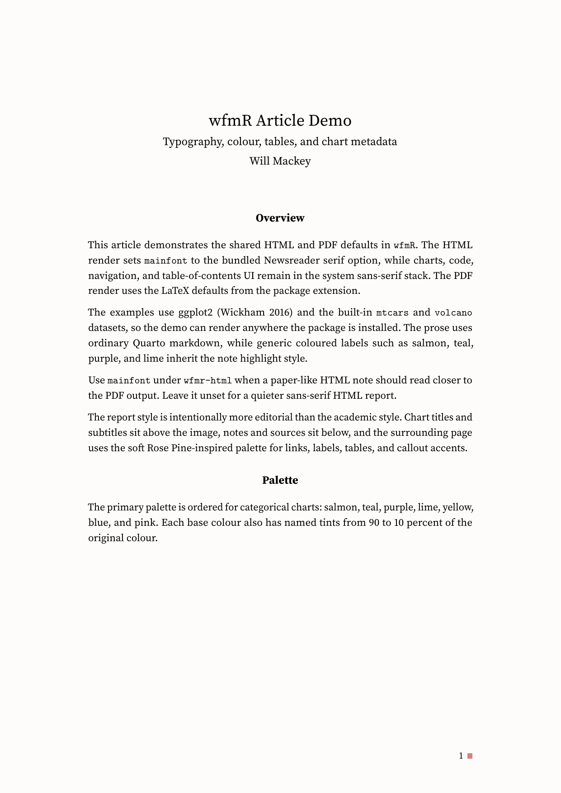

### Academic Article YAML: HTML + PDF

``` yaml
---
title: "Working paper"
subtitle: "Formal figure captions"
author: "Will Mackey"
brand: "_extensions/wfmr-academic/_brand.yml"
abstract: |
  A short abstract or overview sits on the title page below the author block.
  The academic PDF format clears the page after the abstract before starting the
  body text.
format:
  wfmr-academic-html:
    fig-format: svg
    mainfont: "Newsreader, Georgia, Cambria, Iowan Old Style, Palatino Linotype, Palatino, serif"
    linestretch: 1.58
    embed-resources: true
    code-annotations: below
    code-fold: show
    code-tools: true
    toc: true
    toc-location: left
    toc-depth: 3
    toc-expand: true
    fig-cap-location: bottom
    df-print: paged
  wfmr-academic-pdf:
    documentclass: article
    papersize: a4
    geometry:
      - top=1in
      - left=1.3in
      - right=1.3in
      - bottom=1.2in
      - footskip=0.7in
    fontsize: 11pt
    linestretch: 1.2
    toc: false
    colorlinks: true
    linkcolor: black
    citecolor: black
    urlcolor: black
    link-citations: true
    link-bibliography: true
    fig-cap-location: bottom
    tbl-cap-location: top
    fig-pos: tb
    include-in-header:
      text: |
        \wfmAcademicAuthor{Will Mackey}{Australian National University}{Author note for the title-page footnote.}
execute:
  warning: false
  message: false
crossref:
  fig-title: Chart
  fig-prefix: Chart
---
```

[Source QMD](examples/wfmr-academic-demo.qmd) \| [Academic HTML
example](examples/wfmr-academic-demo.html) \| [Academic PDF
example](examples/wfmr-academic-demo.pdf)

Academic HTML screenshot:

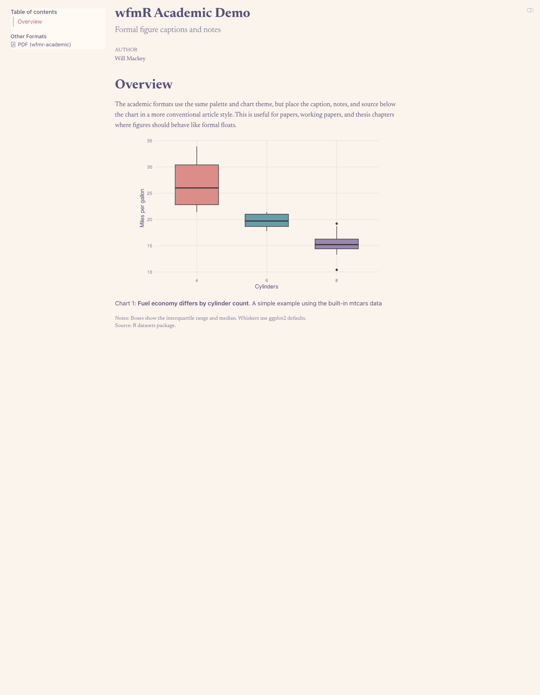

Academic PDF screenshot:

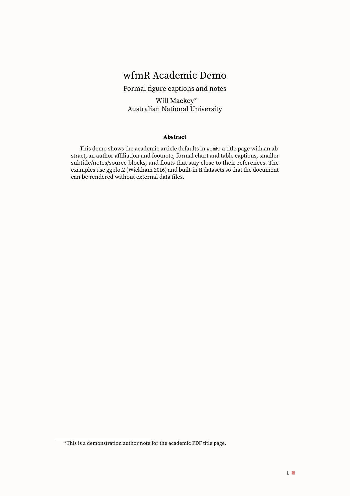

### revealjs YAML

``` yaml
---
title: "Presentation"
author: "Will Mackey"
brand: "_extensions/wfmr/_brand.yml"
format:
  wfmr-revealjs:
    embed-resources: true
    fig-format: svg
    slide-number: c/t
    show-slide-number: all
    preview-links: auto
    transition: fade
    background-transition: fade
    controls: true
    progress: true
    smaller: false
    code-line-numbers: false
    footer: ""
execute:
  warning: false
  message: false
crossref:
  fig-title: Chart
  fig-prefix: Chart
---
```

[Source QMD](examples/wfmr-revealjs-demo.qmd) \| [revealjs
example](examples/wfmr-revealjs-demo.html)

revealjs screenshot:

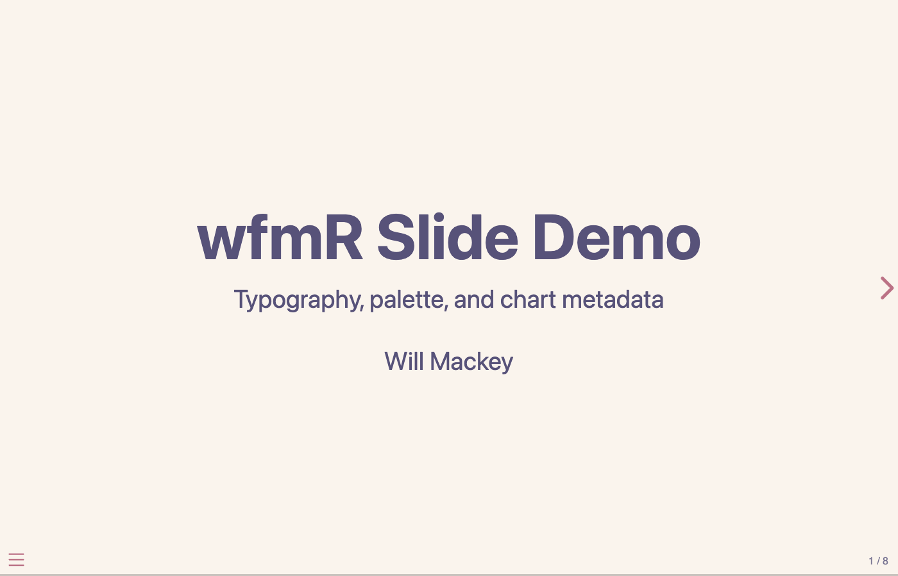

In a setup chunk, call:

``` r
library(wfmR)
wfm_chart_defaults()
wfm_chart_defaults(style = "academic")
```

Plot chunks can then use `chart-title`, `chart-subtitle`, `chart-notes`,
and `chart-source` chunk options. In nice documents, the title/subtitle
render as above-chart headings. In academic PDFs, chart titles render as
plain formal captions below figures, table titles render above tables,
and the subtitle, notes, and source render in a smaller block with the
same float. The bundled Lua filter renders notes and sources in HTML,
PDF, and revealjs outputs.
